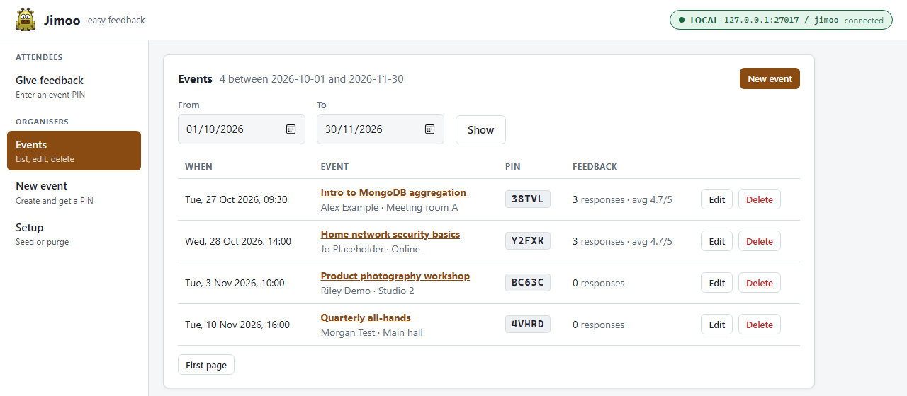
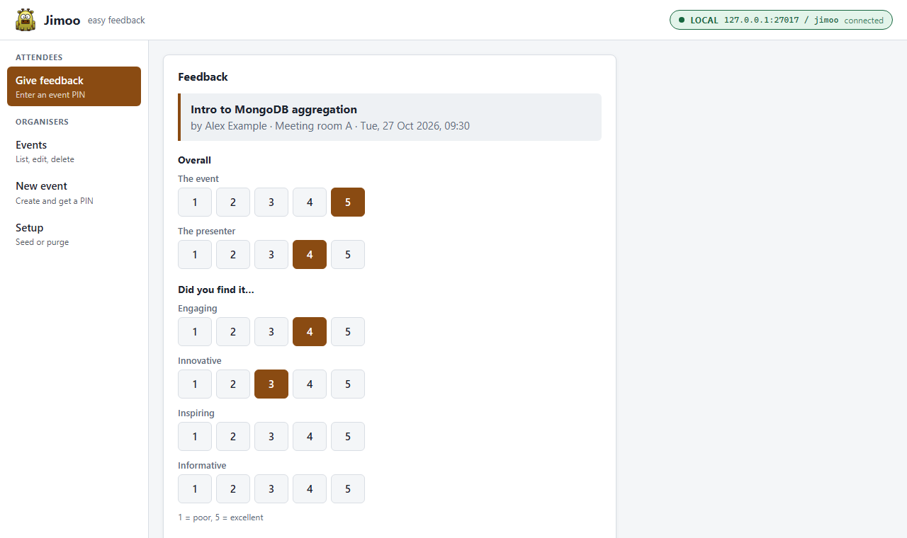
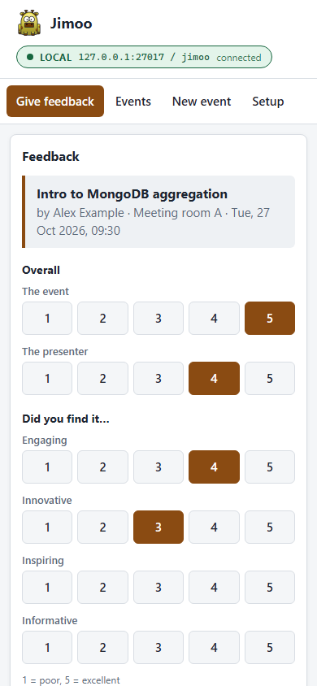
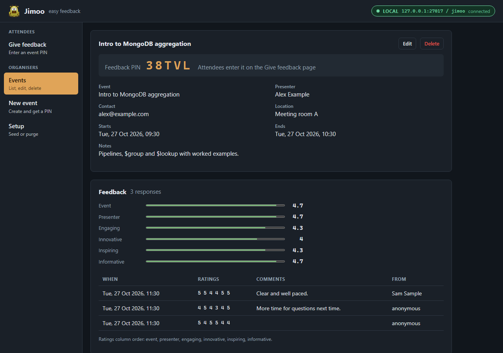
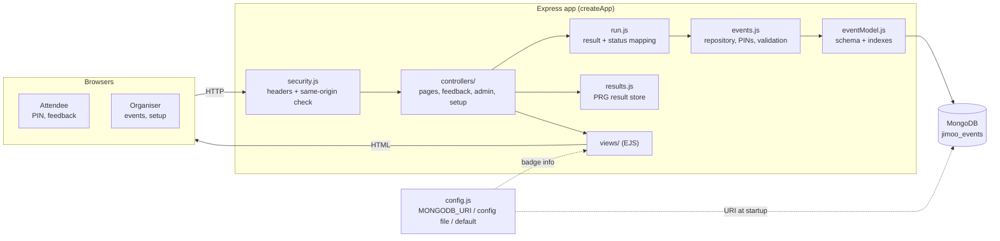
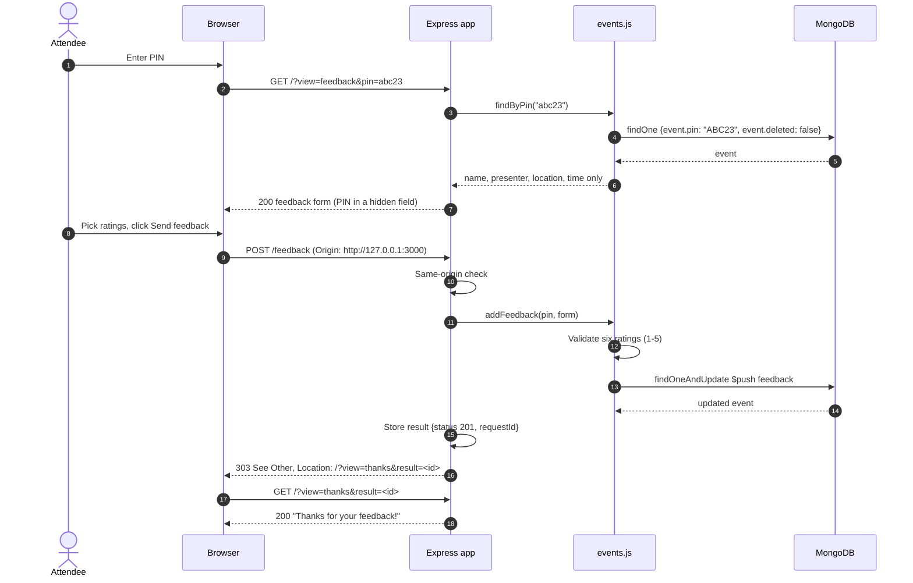

# Jimoo: easy event feedback

Jimoo collects feedback on events: talks, meetings, workshops. An organiser creates an event and gets a 5-character PIN. Attendees enter the PIN, rate the event on six 1–5 scales and can leave a comment. The organiser then sees the averages and every response.

Built with Node.js, Express, EJS and MongoDB (Mongoose). It's a small personal project and learning tool, not a hardened production app; read [Security notes](#security-notes) before exposing it to a network.



## What it does

| Sidebar | What | Route |
| --- | --- | --- |
| Give feedback | Enter a PIN, rate the event, optional comment, name and email | `GET /?view=feedback&pin=…`, `POST /feedback` |
| Events | Events in a date range (default: this month and next), 20 per page, with PIN, response count and average | `GET /?view=events&from=…&to=…` |
| (event page) | PIN, details, average per rating, every response | `GET /?view=event&id=…` |
| New event | Create an event; a unique PIN is generated | `POST /admin/events` |
| (edit) | Change the details. PIN and existing feedback are kept | `POST /admin/events/update` |
| (delete) | Soft delete, with a confirm dialog: hidden from lists, PIN stops working | `POST /admin/events/delete` |
| Setup | Seed four sample events, or purge the collection | `POST /admin/setup/seed`, `POST /admin/setup/purge` |

PINs use `A–Z` and `2–9` without `I`, `O`, `0` and `1`, so they're easy to read out, and they're unique among live events (enforced by a partial unique index). Attendees can type them in lower case.

Attendees only see an event's name, presenter, location and time: never the organiser's email, the event notes or other people's feedback.

<p>
  
  
</p>

Organiser pages also show a response panel with the HTTP status, highlighted JSON, a copy button and a footer with a request ID (generated by the app, for matching against its logs), duration and timestamp. Forms use post/redirect/get: the result is stored briefly and the browser is 303-redirected to a page that shows it, so refreshing never re-submits.

The badge in the header shows which database you're pointed at and whether the app is connected:

- **green / Local**: loopback only (`localhost`, `127.0.0.1`, `::1`)
- **red / Atlas**: `mongodb+srv://` or `*.mongodb.net`, i.e. probably real data
- **amber / Custom host**: anything else

Dark mode follows your OS setting, and the layout works on phones (the sidebar becomes a strip of tabs and tables become stacked cards).



## Requirements

- Node.js 20.19 or later
- A MongoDB server: local install, Docker, or Atlas

## Install and run

```sh
git clone https://github.com/ajyounguk/jimoo
cd jimoo
npm install
npm start
```

Then open <http://127.0.0.1:3000>. Use **Setup → Seed data** for some sample events.

| Env var | Default | Purpose |
| --- | --- | --- |
| `MONGODB_URI` | (see below) | Connection string; overrides the config file |
| `HOST` | `127.0.0.1` | Interface to listen on |
| `PORT` | `3000` | Port to listen on |

If MongoDB is down at startup, the app keeps running, retries every 5 seconds and returns `503` in the meantime.

Dates and times are entered and shown in the server's local time zone.

## Connecting to MongoDB

The connection string comes from, in order:

1. the `MONGODB_URI` environment variable
2. `config/mongo-config.json`: copy `config/mongo-config-sample.json` and edit `"mongourl"` (`"uri"` also works). The sample's `_help` block explains each part of the connection string and is ignored by the app
3. the default, `mongodb://127.0.0.1:27017/jimoo` (no auth)

`config/mongo-config.json` is git-ignored. Keep it that way: it's where the password lives.

Events are stored in the `jimoo_events` collection of the database named in the connection string, in the same document shape as v1, so existing data still loads.

### Quick local MongoDB

The simplest option is Docker, bound to loopback only:

```sh
docker run -d --name jimoo-mongo -p 127.0.0.1:27017:27017 mongo:8
npm start
```

### A database user with only what the app needs

The app needs `find`, `insert`, `update`, `remove` and `createIndex` on one database. The built-in `readWrite` role on that database covers all of these; don't use an admin or `dbOwner` user. In `mongosh`, as an admin:

```js
use jimoo
db.createUser({
  user: "jimoo_user",
  pwd: passwordPrompt(),
  roles: [{ role: "readWrite", db: "jimoo" }]
})
```

```json
{ "mongourl": "mongodb://jimoo_user:<password>@127.0.0.1:27017/jimoo?authSource=jimoo" }
```

### Credentials: prefer short-lived ones

A password in a JSON file is fine for a local setup. For anything real, use Atlas with one of the passwordless options that the MongoDB driver supports in the connection string:

- **AWS IAM** (`authMechanism=MONGODB-AWS`): uses the standard AWS credential provider chain (SSO, profiles, instance or task roles), so there's no long-lived secret in the repo or on disk.
- **OIDC / workload identity** (`authMechanism=MONGODB-OIDC`)
- **X.509 client certificates**

## Security notes

- **No authentication.** Anyone who can reach the app can see every event and its feedback (including attendees' optional names and emails), create, edit and delete events, and purge the whole collection. That's why it binds to `127.0.0.1` by default.
- **Using it at a real event.** Attendees need to reach the app from their phones, which means `HOST=0.0.0.0` or a reverse proxy, and that exposes the organiser pages too. They share the `/` URL with the attendee pages (only `?view=` differs), so a proxy can't easily protect them separately; only the organisers' POSTs live under `/admin/`. Only do this on a network you trust, for the duration of the event. Separating the two with a login is a known gap.
- **PINs are not secrets.** A PIN only lets someone submit feedback. There's no rate limiting, so with no authentication a determined person could guess PINs or submit lots of feedback.
- **CSRF.** POSTs are rejected with `403` unless the `Origin` (or, failing that, `Referer`) header matches the app's host, so a malicious page can't make your browser delete events. Requests with neither header (e.g. `curl`) are allowed. The app sends `Referrer-Policy: same-origin`; don't change it to `no-referrer`, or browsers send `Origin: null` and every form gets a 403.
- **Output escaping.** All data is HTML-escaped in templates, and the JSON highlighter builds DOM nodes with `textContent`. A strict Content-Security-Policy (`default-src 'self'`, no inline script or styles) is set as a second layer.
- **Query injection.** Only known fields are taken from form bodies, always as strings; dates, times, ratings, PINs and IDs are validated; URL-encoded bodies are parsed without nested objects; Mongoose `sanitizeFilter` is on.
- **Errors.** Error responses show the error name, message and MongoDB code with any `user:password@` in URIs masked. The connection string itself is never logged or rendered.

## Changes from v1

v2 (2026) is a rewrite of the 2018 app. The data format is unchanged, but:

- **No shared server state.** v1 kept the "current" event in one object shared by every request, so two people using the app at once could see each other's data, and feedback could be saved against whichever event someone else had last opened. Everything now travels in the URL or the form.
- **Editing no longer wipes feedback**, and edit forms show the event's own date and time (v1 reset them to now).
- **Routes changed.** Deletes, seed and purge are POSTs with confirm dialogs; the old GET routes (`/event/seed`, `/event/purge`, `/admin/event/...`) are gone. `/admin` redirects to the event list.
- **Purge** now empties `jimoo_events` (v1 dropped a collection called `events`, which the app doesn't use).
- **Feedback** must rate all six areas with a whole number from 1 to 5. Event notes are optional.
- The create flow has no separate confirmation step: creating takes you to the event page with its PIN.
- The event list defaults to this month and next (computed per request, not at server start), and is paginated.

### Upgrading v1 data

v1 could give two live events the same PIN (its collision check looked at the wrong field), and seeding twice always did. v2 adds a unique index on the PIN of live events; if your data has duplicates, the index can't be built and the app logs `index build failed on jimoo_events ... E11000 duplicate key` at startup. Everything still works, but PIN uniqueness then relies on a lookup before each insert rather than the database.

To fix it, find the duplicates in `mongosh`:

```js
db.jimoo_events.aggregate([
  { $match: { "event.deleted": false } },
  { $group: { _id: "$event.pin", n: { $sum: 1 }, ids: { $push: "$_id" } } },
  { $match: { n: { $gt: 1 } } }
])
```

Delete the ones you don't need in the app (or Setup → Purge if it's only old seed data), then restart: the index is built on startup.

## Tests

```sh
npm test
```

Uses `node:test` and `supertest`. Route tests inject a fake repository; repository tests and an end-to-end test run against a throwaway `mongod` started by [mongodb-memory-server](https://github.com/typegoose/mongodb-memory-server) on a random loopback port. The first run downloads a MongoDB binary into `node_modules/.cache/mongodb-binaries`.

## Project layout

```
app.js                        createApp() factory; connects and listens only when run directly
lib/config.js                 connection string loading, badge description, credential redaction
lib/events.js                 data access (the only code that talks to Mongoose), PINs, validation
lib/dates.js                  local date/time parsing and formatting
lib/errors.js                 maps Mongoose/driver errors to HTTP statuses
lib/run.js                    runs one operation and packages the result for the response panel
lib/results.js                short-lived store for post/redirect/get results
lib/security.js               security headers and same-origin check
controllers/                  routes: pages, feedback, event admin, setup
models/eventModel.js          event + feedback schema, validation and indexes
views/                        EJS templates (index.ejs + partials/)
public/                       stylesheet, client script, logo
test/                         node:test suites
```

## Architecture



Giving feedback, end to end:



## More info

- MongoDB: <https://www.mongodb.com/docs/>
- Mongoose: <https://mongoosejs.com/docs/>
- Express: <https://expressjs.com/>
